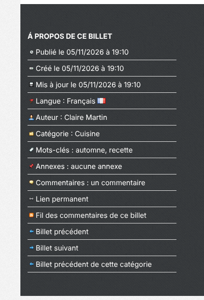
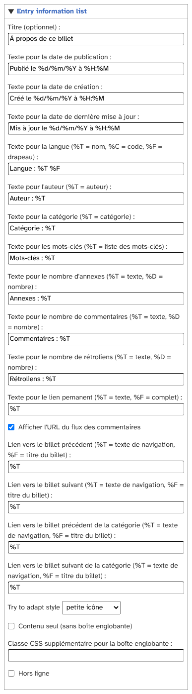
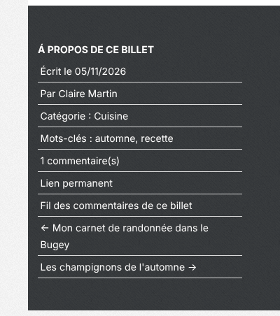

# postInfoWidget : guide d'utilisation

postInfoWidget ajoute un widget qui affiche les informations d'un billet (dates, auteur, catégorie, mots-clés, nombre de commentaires, liens de navigation…) dans une zone du thème, par exemple la colonne latérale.

## Table des matières

1. [Ajouter le widget](#ajouter-le-widget)
2. [Les réglages](#les-réglages)
3. [Les codes utilisables](#les-codes-utilisables)
4. [Personnaliser l'affichage](#personnaliser-laffichage)
5. [Bon à savoir](#bon-à-savoir)

## Ajouter le widget

Allez dans **Widgets**, ajoutez le widget « Entry information list » (son nom n'est pas traduit en français) à la zone de votre choix, puis enregistrez.

Le widget n'apparaît que sur la page d'un billet. Sur l'accueil, les listes de billets, etc., il est invisible.

## Les réglages

Cliquez sur le nom du widget pour déplier ses réglages.

Chaque ligne d'information correspond à un champ texte. **Laissez le champ vide pour ne pas afficher la ligne.**

* **Titre** : le titre du widget (« À propos de ce billet » par défaut).
* Dates de publication, de création et de dernière mise à jour. Le format utilise les codes de date PHP (`%d/%m/%Y %H:%M`).
* Langue, auteur, catégorie, mots-clés.
* Nombre d'annexes, de commentaires et de rétroliens.
* Lien permanent.
* **Afficher l'URL du flux des commentaires**.
* Liens vers le billet précédent ou suivant, du blog entier ou de la même catégorie.
* **Style** : sans style, petite icône ou icône normale devant chaque ligne.
* Les options habituelles des widgets : contenu seul, classe CSS, hors ligne.

## Les codes utilisables

Dans les textes, ces codes sont remplacés :

* `%T` : la valeur (nom de la langue, auteur, catégorie, liste des mots-clés, lien…) ;
* `%C` : le code de la langue (ex. `fr`) ;
* `%F` : le drapeau de la langue ; pour le lien permanent, l'adresse complète ; pour la navigation, le titre du billet comme texte du lien ;
* `%D` : un nombre, pour les annexes, les commentaires et les rétroliens (au lieu de « un commentaire », « 2 commentaires »…).

Pour la navigation, `%T` est le texte du lien (« Billet précédent ») et `%F` le titre du billet voisin.

## Personnaliser l'affichage

Exemple : seuls la date, l'auteur, la catégorie, les mots-clés, le nombre de commentaires et la navigation sont gardés, sans icônes.

Les réglages utilisés : `Écrit le %d/%m/%Y`, `Par %T`, `%D commentaire(s)`, `← %F` et `%F →`, style « sans style », les autres champs vidés.

Certaines lignes n'apparaissent que si elles ont un sens : la catégorie si le billet en a une, les mots-clés s'il y en a (plugin Tags), les commentaires et rétroliens s'ils sont ouverts, les liens de navigation s'il existe un billet voisin.

## Bon à savoir

* Le nom du widget (« Entry information list ») et le libellé de l'option de style (« Try to adapt style ») ne sont pas traduits en français.
* Plusieurs fautes dans l'interface en français : « Á propos de ce billet » (titre par défaut), « lien pemanent ».
* Le widget ne fonctionne que sur les billets : il n'apparaît pas sur les pages statiques.
